## Activité 1-1 : Première connexion Client/Serveur

**Objectif :** établir une communication Client/Serveur en Java avec des sockets TCP en mode connecté.

### Étape 1 : Préparation de l'environnement Git

Commande exécutée : `git --version`

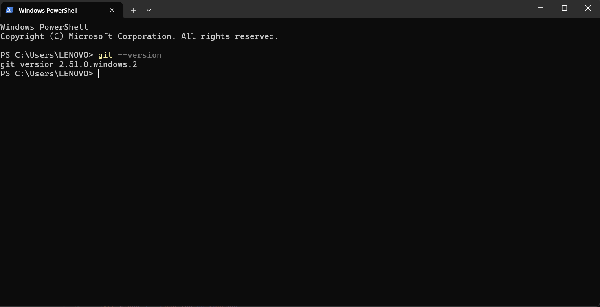

**Description :** *(Git est correctement installé)*

### Étape 2 : Préparation de l'environnement Java

Commande exécutée : `java --version`

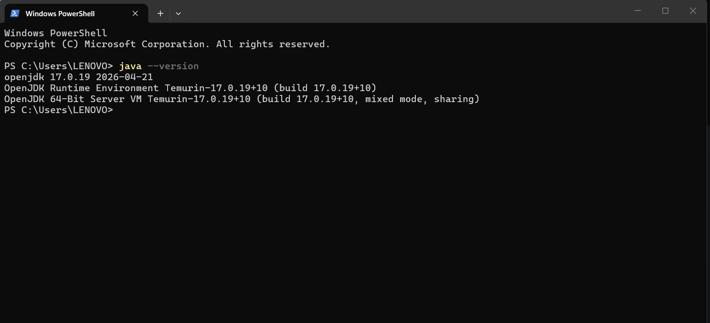

**Description :** *(Le JDK est installé et accessible depuis le terminal )*

Création du répertoire de travail et du projet `TP1-DAR2026` dans IntelliJ avec un dépôt Git :

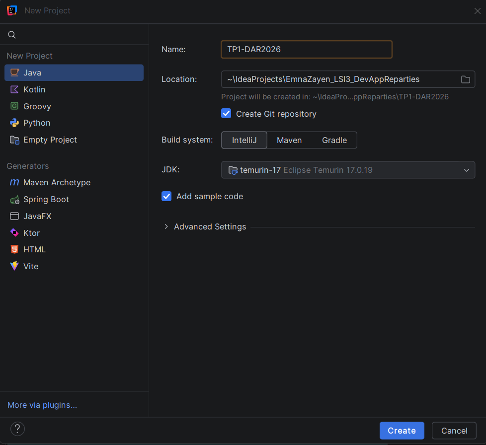

**Description :** création du projet `TP1-DAR2026` dans le répertoire de travail `EmnaZayen_LSI3_DevAppReparties`*

### Étape 3 : Création du serveur

Classe `serverPackage.Server` :

```java
package serverPackage;

import java.io.IOException;
import java.net.ServerSocket;
import java.net.Socket;

public class Server1_1 {
    public static void main(String[] args) {
        try {
            // Première étape : créer le ServerSocket sur le port 1234
            ServerSocket serverSocket = new ServerSocket(1234);
            System.out.println("Je suis un serveur en attente la connexion d'un client ");

            // Deuxième étape : accept() BLOQUE jusqu'à l'arrivée d'un client
            Socket socket = serverSocket.accept();
            System.out.println("un client est connecté");

            // Dernière étape : fermer les sockets
            socket.close();
            serverSocket.close();
        } catch (IOException e) {
            e.printStackTrace();
        }
    }
}
```

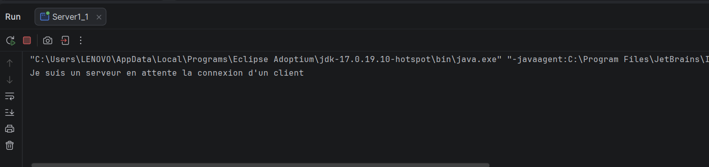

**Description  :** le serveur crée un `ServerSocket` sur le port 1234 et affiche son message. Il reste ensuite bloqué sur `accept()`, une méthode bloquante, jusqu'à l'arrivée d'un client. Le programme ne se termine donc pas tant qu'aucun client ne se connecte.

### Étape 4 : Création du client

Classe `clientPackage.Client` :

```java
package clientPackage;

import java.io.IOException;
import java.net.Socket;

public class Client1_1 {
    public static void main(String[] args) {
        try {
            // Première étape : le client n'est pas encore connecté
            System.out.println("Je suis un client pas encore connecté…");

            // Connexion au serveur (adresse + port)
            Socket socket = new Socket("localhost", 1234);
            System.out.println("je suis un client connecté");

            // Dernière étape : fermer le socket
            socket.close();
        } catch (IOException e) {
            e.printStackTrace();
        }
    }
}
```

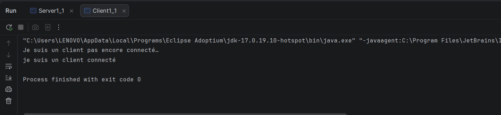
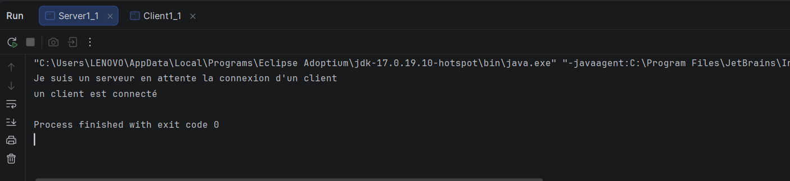

**Description :** le client lance la connexion TCP vers `localhost:1234`. Une fois la connexion établie, le client affiche « je suis un client connecté » et le serveur affiche « un client est connecté ». Les deux programmes ferment ensuite leurs sockets et se terminent.

**Remplacement de `localhost` par une adresse IP (`127.0.0.1`) :**

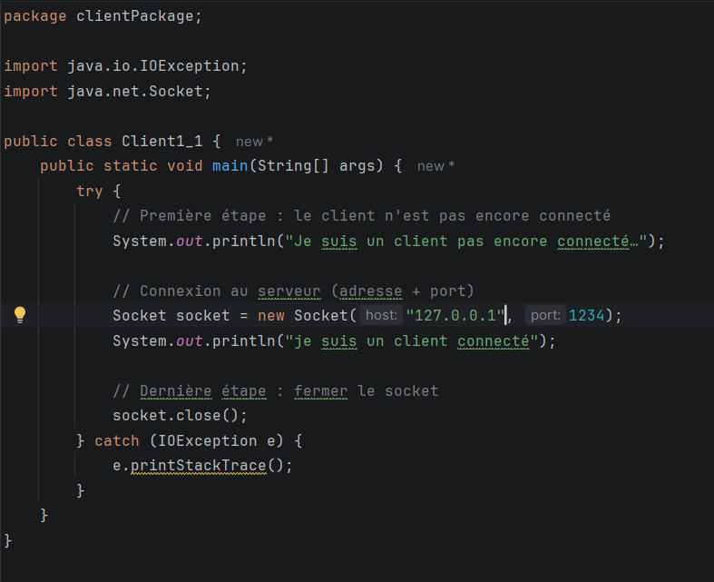

**Description :** le résultat est identique, car `localhost` est un nom que le système résout en `127.0.0.1` (interface de bouclage).

### Étape 5 : Dépôt des livrables

Lien du repository : *(https://github.com/emnazayen8-ops/TP1-DAR2026)*

---

## Activité 1-2 : Service de calculatrice (x * 5)

**Objectif :** étendre l'application pour que le serveur effectue un calcul (multiplication par 5) demandé par le client.

### Étape 2 : Création du service de multiplication


**Serveur :**

```java
package serverPackage;

import java.io.DataInputStream;
import java.io.DataOutputStream;
import java.io.EOFException;
import java.io.IOException;
import java.net.ServerSocket;
import java.net.Socket;

public class Server1_2 {
    public static void main(String[] args) {
        try (ServerSocket serverSocket = new ServerSocket(1234)) {
            System.out.println("Serveur en attente d'un client...");
            Socket socket = serverSocket.accept();
            System.out.println("Un client est connecté");

            DataInputStream in = new DataInputStream(socket.getInputStream());
            DataOutputStream out = new DataOutputStream(socket.getOutputStream());

            int x;
            do {
                x = in.readInt();               // (c) réception (bloquant)
                int resultat = x * 5;           // (d) calcul côté serveur
                out.writeInt(resultat);         // (e) envoi du résultat
                out.flush();                    // force l'envoi immédiat
                System.out.println("Reçu : " + x + " -> envoyé : " + resultat);
            } while (x != 0);                   // 0 = fin de session

            System.out.println("Fin de session, fermeture.");
            in.close();
            out.close();
            socket.close();

        } catch (EOFException e) {
            System.out.println("Le client s'est déconnecté brutalement.");
        } catch (IOException e) {
            e.printStackTrace();
        }
    }
}
```

**Client :**

```java
package clientPackage;

import java.io.DataInputStream;
import java.io.DataOutputStream;
import java.io.IOException;
import java.net.Socket;
import java.util.Scanner;

public class Client1_2 {
    public static void main(String[] args) {
        try (Socket socket = new Socket("localhost", 1234);
             Scanner sc = new Scanner(System.in)) {

            System.out.println("Connecté au serveur.");
            DataOutputStream out = new DataOutputStream(socket.getOutputStream());
            DataInputStream in = new DataInputStream(socket.getInputStream());

            int x;
            do {
                System.out.print("Entrez un entier (0 pour quitter) : ");
                x = sc.nextInt();               // (a) saisie clavier
                out.writeInt(x);                // (b) envoi au serveur
                out.flush();
                int resultat = in.readInt();    // (f) réception du résultat
                System.out.println(x + " x 5 = " + resultat);
            } while (x != 0);

            System.out.println("Fermeture de la connexion.");

        } catch (IOException e) {
            e.printStackTrace();
        }
    }
}
```
**Description :** DataOutputStream et DataInputStream jouent le rôle de traducteurs : l’un transforme un nombre en octets pour l’envoyer, l’autre reçoit ces octets et reconstruit le nombre d’origine. Ainsi, le client et le serveur se comprennent, même avec des nombres négatifs.

### Tests avec différentes valeurs

| Valeur de x        | Résultat attendu | Capture |
|--------------------|---|---|
| Positive (ex : 7)  | 35 | 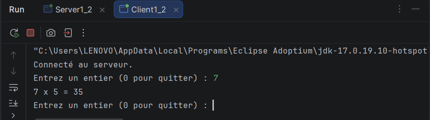 |
| Négative (ex : -4) | -20 | 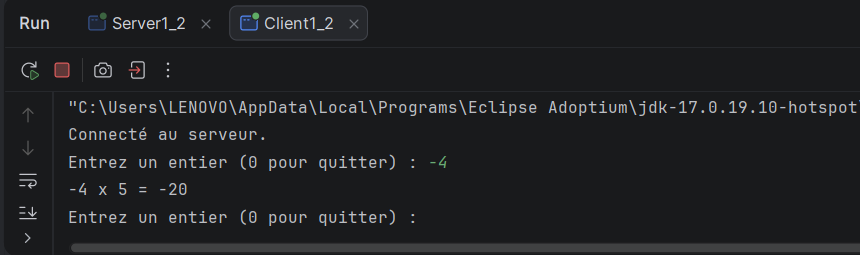 |
| Zéro               | 0 (fin de session) | 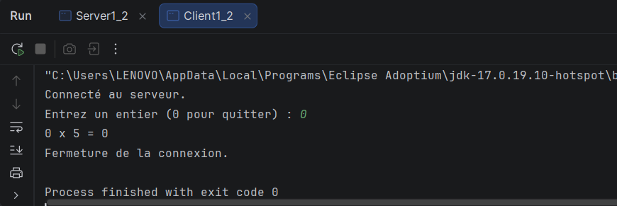 |

**Description :** *(Le serveur calcule correctement x * 5 pour les valeurs positives et négatives grâce à `writeInt`/`readInt`. La valeur 0 sert de sentinelle : le client l'envoie, le serveur répond 0 puis les deux ferment leurs sockets.)*

### Saisie de plusieurs entiers successivement

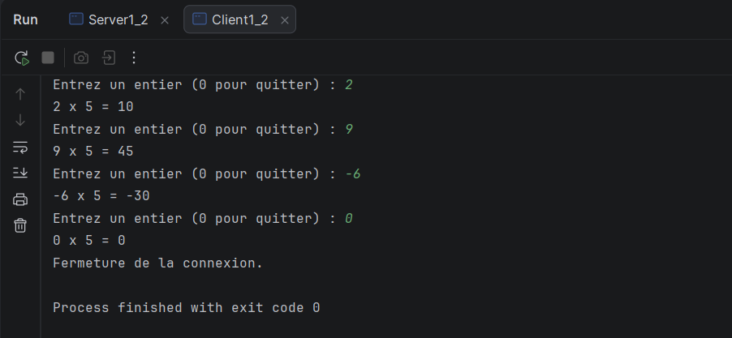
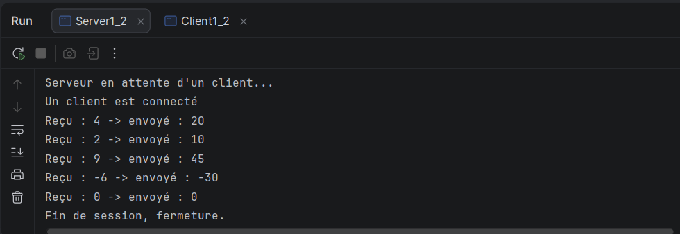

**Description :** le client saisit des entiers successivement, envoie chacun au serveur, reçoit le produit et l'affiche. La boucle continue tant que l'entier saisi est différent de 0. Quand 0 est saisi, la communication s'arrête proprement et les sockets sont fermés des deux côtés.


---

## Activité 1-3 : Amélioration du service de calculatrice

### Étape 1 : Connexion Client/Serveur sur deux machines distinctes

Adresse IP de la machine (`ipconfig`) :

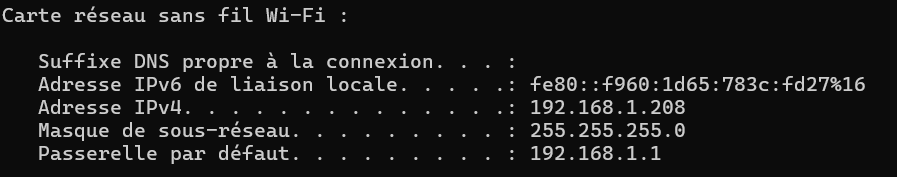

Test de connectivité (`ping`) vers cette adresse IP :

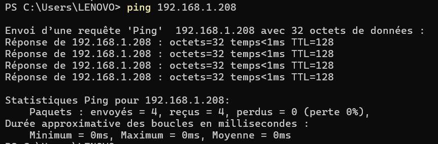


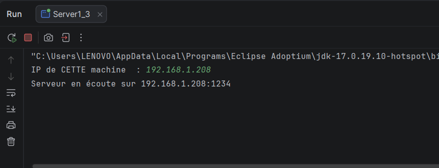
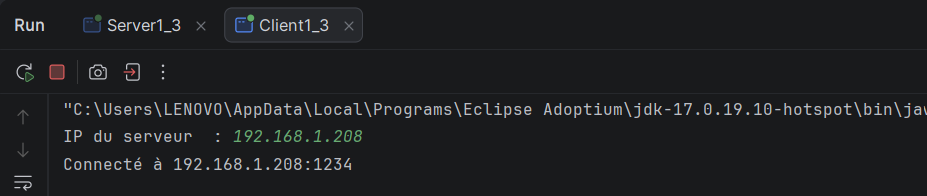

**Description :** *(le serveur et le client ont été exécutés sur la même machine, en utilisant son adresse IPv4 réelle à la place de `localhost`. Le code ne change pas pour un test entre deux machines : seule l'adresse saisie côté client doit être celle de la machine du serveur.)*

### Étape 2 : Service de calculatrice amélioré

**Protocole d'échange :**

```
Client → Serveur : writeInt(choix)   [1=+, 2=-, 3=*, 4=/, 0=quitter]
                   writeDouble(x)
                   writeDouble(y)
Serveur → Client : writeUTF(message) ("Résultat = ..." ou "Erreur : ...")
```

**Serveur :**

```java
package serverPackage;

import java.io.DataInputStream;
import java.io.DataOutputStream;
import java.io.EOFException;
import java.io.IOException;
import java.net.InetAddress;
import java.net.InetSocketAddress;
import java.net.ServerSocket;
import java.net.Socket;
import java.util.Scanner;

public class Server1_3 {
    public static void main(String[] args) {
        Scanner sc = new Scanner(System.in);
        System.out.print("IP de CETTE machine  : ");
        String ip = sc.nextLine().trim();
        int port = 1234;

        try (ServerSocket serverSocket = new ServerSocket()) {
            serverSocket.bind(new InetSocketAddress(InetAddress.getByName(ip), port));
            System.out.println("Serveur en écoute sur " + ip + ":" + port);

            Socket socket = serverSocket.accept();
            System.out.println("Client connecté : "
                    + socket.getInetAddress().getHostAddress());

            DataInputStream in = new DataInputStream(socket.getInputStream());
            DataOutputStream out = new DataOutputStream(socket.getOutputStream());

            int choix;
            do {
                choix = in.readInt();
                if (choix == 0) break;          // le client veut quitter

                double x = in.readDouble();
                double y = in.readDouble();
                String reponse;

                switch (choix) {
                    case 1: reponse = "Résultat = " + (x + y); break;
                    case 2: reponse = "Résultat = " + (x - y); break;
                    case 3: reponse = "Résultat = " + (x * y); break;
                    case 4:
                        if (y == 0) reponse = "Erreur : division par zéro";
                        else        reponse = "Résultat = " + (x / y);
                        break;
                    default: reponse = "Erreur : opération inconnue";
                }
                out.writeUTF(reponse);
                out.flush();
                System.out.println("Opération " + choix + " : " + reponse);
            } while (true);

            System.out.println("Session terminée.");
            socket.close();

        } catch (EOFException e) {
            System.out.println("Le client s'est déconnecté brutalement.");
        } catch (IOException e) {
            e.printStackTrace();
        }
    }
}
```

**Client :**

```java
package clientPackage;

import java.io.DataInputStream;
import java.io.DataOutputStream;
import java.io.IOException;
import java.net.InetSocketAddress;
import java.net.Socket;
import java.util.Scanner;

public class Client1_3 {
    public static void main(String[] args) {
        Scanner sc = new Scanner(System.in);
        System.out.print("IP du serveur  : ");
        String ipServeur = sc.nextLine().trim();
        int port = 1234;

        try (Socket socket = new Socket()) {
            // connexion avec un délai maximal de 5 secondes
            socket.connect(new InetSocketAddress(ipServeur, port), 5000);
            System.out.println("Connecté à " + ipServeur + ":" + port);

            DataOutputStream out = new DataOutputStream(socket.getOutputStream());
            DataInputStream in = new DataInputStream(socket.getInputStream());

            int choix;
            do {
                System.out.println("\n===== CALCULATRICE =====");
                System.out.println("1. Addition");
                System.out.println("2. Soustraction");
                System.out.println("3. Multiplication");
                System.out.println("4. Division");
                System.out.println("0. Quitter");
                System.out.print("Votre choix : ");
                choix = sc.nextInt();

                out.writeInt(choix);
                out.flush();
                if (choix == 0) break;

                System.out.print("x = ");
                double x = sc.nextDouble();
                System.out.print("y = ");
                double y = sc.nextDouble();

                out.writeDouble(x);
                out.writeDouble(y);
                out.flush();

                System.out.println(in.readUTF());   // résultat envoyé par le serveur
            } while (true);

            System.out.println("Au revoir !");

        } catch (IOException e) {
            System.out.println("Impossible de joindre le serveur : " + e.getMessage());
        }
    }
}
```
C:\Users\LENOVO\IdeaProjects\EmnaZayen_LSI3_DevAppReparties\TP1-DAR2026\images
### Tests des quatre opérations

| Opération | Valeurs | Résultat attendu           | Capture                                           |
|---|---------|----------------------------|---------------------------------------------------|
| Addition | 5 + 3   | 8.0                        | 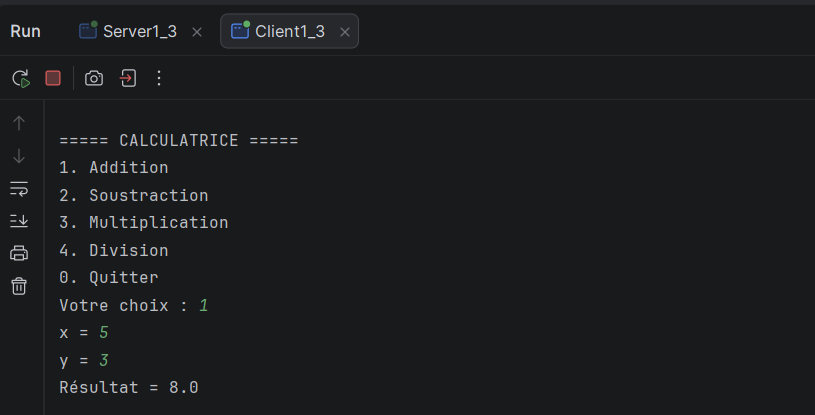              |
| Soustraction | 5 - 8   | -3.0                       | 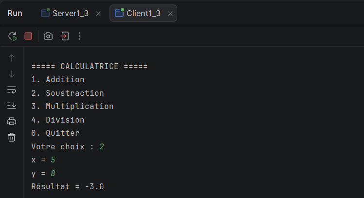      |
| Multiplication | 4 * 2   | 8.0                        | 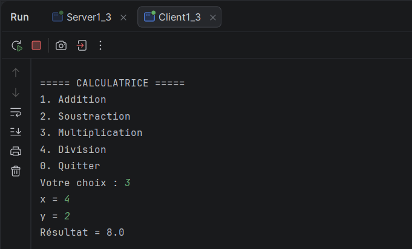  |
| Division | 10 / 4  | 2.5                        | 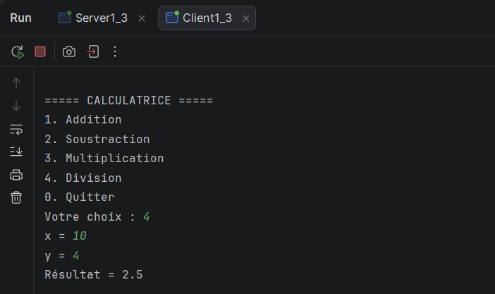              |
| Division par zéro | 7 / 0   | Erreur : division par zéro | 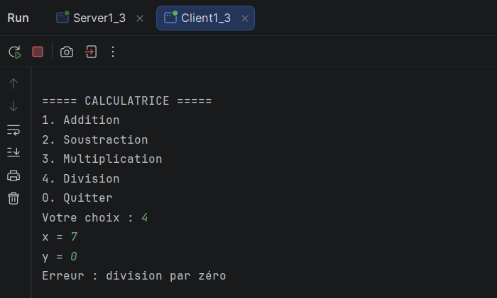 |

**Interprétation :** *(Le menu est présenté côté client. Le choix et les opérandes sont transmis au serveur, qui effectue le calcul et renvoie le résultat sous forme de texte (`writeUTF`).)*


**Configuration utilisée :**
- Les classes `InetAddress` et `InetSocketAddress` gèrent l'adresse IP et le port.
- **Côté serveur :** `serverSocket.bind(new InetSocketAddress(InetAddress.getByName(ip), port))` met le `ServerSocket` en écoute sur l'adresse IP réelle de la machine.
- **Côté client :** `socket.connect(new InetSocketAddress(ipServeur, port), 5000)` remplace `localhost` par l'IP du serveur, avec un délai maximal de 5 secondes.
- Le pare-feu a été configuré pour autoriser le port 1234 sur le réseau privé.
---
